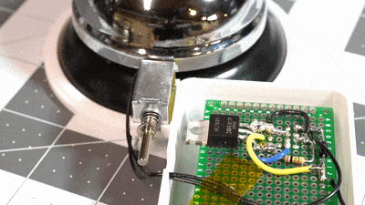
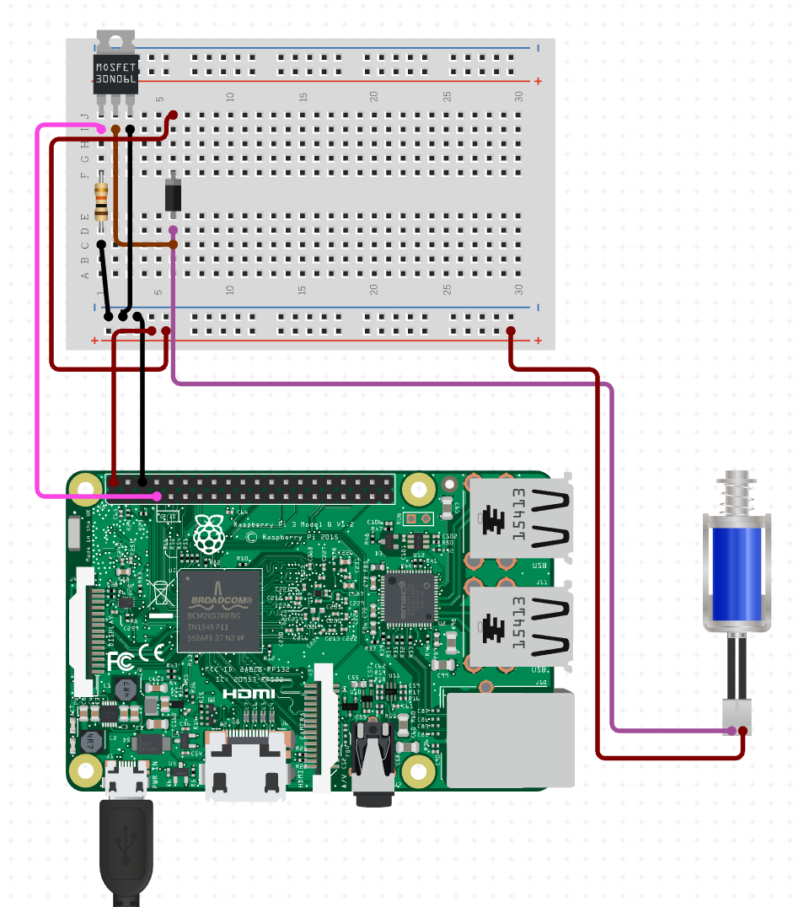

# Raspberry Pi Bell Slapper

_a.k.a. "The King of Ding", harbinger of the Internet of Dings_

[](https://github.com/geerlingguy/pi-bell-slapper/actions?query=workflow%3ACI)

<p align="center">
  
</p>

Why? I need a Raspberry Pi to slap a bell in response to a particular trigger.

In my case, it's for a radiothon. When a nonprofit community radio station gets a phone call, you can hear the phone in the background. When they get an online donation, you hear nothing.

Something is better than nothing, so I made this project, which slaps a bell upon a triggering condition.

## Is there a video of the build process?

Why, yes! How did you know?

Watch these videos for more on the build:

  - [The Raspberry Pi Internet of Dings Notification Bell](https://www.youtube.com/watch?v=o5wOzNzShrA) (June 2021 - "Clarence 2.0")
  - [The Raspberry Pi Bell Slapper - a software-controlled bell](https://www.youtube.com/watch?v=Etr7uIL9spg) (December 2020 - "Bell Slapper Mark I")

## How is the bell slapped?

I thought you'd never ask!

The bell is hit by a solenoid, specifically the [uxcell 4.5V mini Push-Pull Solenoid](https://amzn.to/2UkcLvh) I bought from Amazon.

<p align="center">
  
</p>

The Pi tells the solenoid to trigger, and a little circuit I built as a hacked-together Pi HAT fires off a short pulse of energy to hit the side of the bell directly.

> In 2020, the original "Mark I" version of the bell was slapped quite differently, using a servo. Read the [Mark I README](README-Mark-I.md) for more information about _that_ version of the bell.

## What kind of bell does it slap?

I'm currently slapping a boring old call bell. [This call bell](https://amzn.to/3iCUL5F). But any bell you could mount to be slapped would work.

## How do I slap a bell?

I'm glad you asked! You'll need to gather some parts and solder together a little control circuit, since the Pi can't drive a 1A solenoid directly through a GPIO pin.

### Parts Needed

  - [Raspberry Pi Zero W](https://www.raspberrypi.org/products/raspberry-pi-zero-w/)
  - [Micro USB Power adapter](https://amzn.to/3zGpCrL)
  - [5V Push-Pull Solenoid](https://amzn.to/3cYFxI2)
  - [Double-sided Prototyping board](https://amzn.to/3zTqrxE)
  - [IRL7833PBF MOSFET Transistor - 30V 150A](https://amzn.to/3iYr3Mj)
  - [1A 50V Diode](https://amzn.to/3wNcJtY)
  - 10K Ohm Resistor
  - [Electronics hook-up wire](https://amzn.to/3xEUxCS)
  - [2x4 8-pin female headers](https://amzn.to/3vLDa1O)

### Tools Needed

These are the tools I used to put everything together (though you can use any suitable substitute):

  - [Weller WES51 Soldering Station](https://amzn.to/3iUX6g8)
  - [Adjustable Circuit board holder](https://amzn.to/35CrgNo) (not necessary but helpful)
  - [Ender 3 v2 3D Printer](https://amzn.to/3xGxojo)

### Assembly

Check out [this circuit diagram on Circuito.io](https://www.circuito.io/app?components=9443,11015,200000):

<p align="center">
  
</p>

You could just stick everything into a breadboard like it's laid out in that diagram, but I decided to take a small protoboard and solder everything more permanently into a makeshift HAT that attaches to the top of the Pi Zero directly.

TODO: Add more detailed directions for wiring everything together—maybe also build a custom PCB?

## How do I contain this bell-slapping awesomeness?

I'm glad you asked. Over in the [`enclosure`](enclosure) directory, there are STL files for a case and lid. Print those on a 3D printer, mount everything inside, and you'll be good to go!

For the current design, I use friction and gravity to hold the Pi Zero and custom HAT in place, and superglue to hold in the solenoid.

The case design is derived from [@tenderlove's Analog Terminal Bell case](https://github.com/tenderlove/analog-terminal-bell/tree/master/case), and is modeled in OpenSCAD. The source files are also in the `enclosure` directory, should you like them.

## How do I control the Bell Slapper?

`server.py` serves a small web UI and HTTP API for slapping the bell (and optionally playing a sound) from any device on your network. It uses only the Python standard library, so there's nothing to `pip install`.

Install the system dependencies (`ffmpeg` is used to validate and convert uploaded sounds; `aplay` plays them):

```
sudo apt install -y git python3-rpi-lgpio ffmpeg alsa-utils
git clone https://github.com/geerlingguy/pi-bell-slapper.git ~/pi-bell-slapper
```

> On older Pi OS releases, `python3-rpi.gpio` works too.

Install and start the systemd service (edit `User=` and the paths in `bell-slapper.service` if you're not using the `pi` user):

```
sudo cp ~/pi-bell-slapper/bell-slapper.service /etc/systemd/system/
sudo systemctl daemon-reload
sudo systemctl enable --now bell-slapper
```

Then visit `http://bell-slapper.local/` (or whatever your Pi's hostname is).

Settings and uploaded sounds are stored in `/var/lib/bell-slapper`. Uploads must be WAV, AIFF, MP3, or M4A and 10 seconds or less; they're converted to 48 kHz WAV on upload, and the original file is discarded.

> To test without a Pi, run `./server.py --port 8080 --dry-run`.

### API

The bell will never ding more than once per second. While a ding sequence is running, new ding requests get a `429` response.

| Request | Description |
| --- | --- |
| `GET /api/status` | Current settings, available sounds, and whether the bell is busy. |
| `POST /api/ding` | Ding the bell. Optional parameters: `count` (1-10), `interval` (1-10 seconds), `sound` (`true` to play the selected sound after the last ding), `sound_name`. |
| `PUT /api/settings` | Update `interval` and/or `sound`. |
| `POST /api/sounds?name=file.mp3` | Upload a sound (raw file as the request body). |
| `DELETE /api/sounds/NAME` | Delete a sound. |

Parameters can be passed in the query string or as a JSON body. For example:

```
curl -X POST 'http://bell-slapper.local/api/ding?count=3&sound=true'
curl -X PUT http://bell-slapper.local/api/settings -d '{"interval": 2.5}'
curl -X POST --data-binary @tada.mp3 'http://bell-slapper.local/api/sounds?name=tada.mp3'
```

### Sound output

Sounds play through the default ALSA device. If you're using a USB sound card, find its card number:

```
$ cat /proc/asound/modules
 1 snd_usb_audio
```

Then create `/etc/asound.conf` to make it the default (`plug` handles any sample rate conversion the card needs):

```
pcm.!default {
        type plug
        slave.pcm "hw:1,0"
}

ctl.!default {
        type hw
        card 1
}
```

Verify it's working with `speaker-test -c2 -twav -l7`.

## How do I tie email notifications to the bell slapper?

I built this project to monitor an email inbox. The `email_check.py` script translates "new email arrives" into "the bell has been resoundingly slapped", by calling the API above.

  1. Copy `config.example.yml` to `config.yml`, and modify it with the email credentials for the account to be monitored.
  2. Install dependencies: `sudo apt install -y python3-imapclient python3-yaml`

Then run `./email_check.py`, and prepare to be amazed! Or not, especially if it doesn't work.

### How do I continuously check the email inbox?

For now, I'm just using cron. Fire up the ol' crontab editor (`crontab -e`) and add the following line:

```
* * * * * /home/pi/pi-bell-slapper/email_check.py
```

Then every minute the script will run!

> Note: If you have any errors, cron will email them to localhost (make sure you have something like `postfix` and `mailutils` installed to catch and read those emails). Other cron output goes into the syslog (check `/var/log/syslog`).

If you're using a Pi like the model A+, which doesn't have built-in WiFi, and you're using a cheap USB WiFi dongle to connect to the Internet, there's a chance it will go into a sleep mode after a minute or so—follow [these directions to stop the thing from sleeping](https://www.jeffgeerling.com/blogs/jeff-geerling/edimax-ew-7811un-tenda-w311mi-wifi-raspberry-pi).

## Were you inspired by anyone?

Of course I was inspired. You don't think I came up with all this on my own, did you? Alex Meub's [Office Bell Ringer](https://alexmeub.com/office-bell-ringer/) was my inspiration. Go read that post if you want to discover how I was inspired.

The enclosure design was inspired by Aaron Patterson's [Analog Terminal Bell](https://github.com/tenderlove/analog-terminal-bell).

Why are you so interested in _my_ inspiration? Go find your own.

## Is this project sponsored?

Technically, no. But monetarily, yes! Special thanks to the folks at [WTI](https://www.wti.com) ([@wtinetworkgear](https://github.com/wtinetworkgear)) for sponsoring this project.

You can sponsor too, via [GitHub Sponsors](https://github.com/sponsors/geerlingguy)!

## Who are you?

I'm [Jeff Geerling](https://www.jeffgeerling.com), and I approve of this repository.
