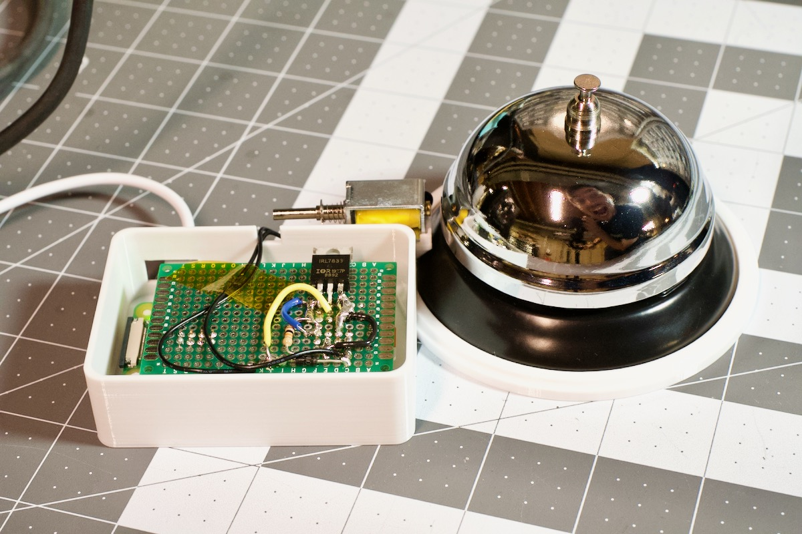

# Raspberry Pi Bell Slapper

_a.k.a. "The King of Ding", harbinger of the Internet of Dings_

[](https://github.com/geerlingguy/pi-bell-slapper/actions?query=workflow%3ACI)

<p align="center">
  
</p>

Why? I need a Raspberry Pi to slap a bell in response to a particular trigger.

In my case, it's for a radiothon. When a nonprofit community radio station gets a phone call, you can hear the phone in the background. When they get an online donation, you hear nothing.

Something is better than nothing, so I made this project, which slaps a bell upon a triggering condition.

## Is there a video of the build process?

Why, yes! How did you know?

Watch these videos for more on the build:

  - [The Raspberry Pi Internet of Dings Notification Bell](https://www.youtube.com/watch?v=o5wOzNzShrA) (June 2021 - "Clarence 2.0")
  - [The Raspberry Pi Bell Slapper - a software-controlled bell](https://www.youtube.com/watch?v=Etr7uIL9spg) (December 2020 - "Bell Slapper Mark I")

## How is the bell slapped?

I thought you'd never ask!

The bell is hit by a solenoid, specifically the [uxcell 4.5V mini Push-Pull Solenoid](https://amzn.to/2UkcLvh) I bought from Amazon.

<p align="center">
  
</p>

The Pi tells the solenoid to trigger, and a little circuit I built as a hacked-together Pi HAT fires off a short pulse of energy to hit the side of the bell directly.

> In 2020, the original "Mark I" version of the bell was slapped quite differently, using a servo. Read the [Mark I README](README-Mark-I.md) for more information about _that_ version of the bell.

## What kind of bell does it slap?

I'm currently slapping a boring old call bell. [This call bell](https://amzn.to/3iCUL5F). But any bell you could mount to be slapped would work.

## How do I slap a bell?

I'm glad you asked! You'll need to gather some parts and solder together a little control circuit, since the Pi can't drive a 1A solenoid directly through a GPIO pin.

### Parts Needed

  - [Raspberry Pi Zero W](https://www.raspberrypi.org/products/raspberry-pi-zero-w/)
  - [Micro USB Power adapter](https://amzn.to/3zGpCrL)
  - [5V Push-Pull Solenoid](https://amzn.to/3cYFxI2)
  - [Double-sided Prototyping board](https://amzn.to/3zTqrxE)
  - [IRL7833PBF MOSFET Transistor - 30V 150A](https://amzn.to/3iYr3Mj)
  - [1A 50V Diode](https://amzn.to/3wNcJtY)
  - 10K Ohm Resistor
  - [Electronics hook-up wire](https://amzn.to/3xEUxCS)
  - [2x4 8-pin female headers](https://amzn.to/3vLDa1O)

### Tools Needed

These are the tools I used to put everything together (though you can use any suitable substitute):

  - [Weller WES51 Soldering Station](https://amzn.to/3iUX6g8)
  - [Adjustable Circuit board holder](https://amzn.to/35CrgNo) (not necessary but helpful)
  - [Ender 3 v2 3D Printer](https://amzn.to/3xGxojo)

### Assembly

Check out [this circuit diagram on Circuito.io](https://www.circuito.io/app?components=9443,11015,200000):

<p align="center">
  
</p>

You could just stick everything into a breadboard like it's laid out in that diagram, but I decided to take a small protoboard and solder everything more permanently into a makeshift HAT that attaches to the top of the Pi Zero directly.

TODO: Add more detailed directions for wiring everything together—maybe also build a custom PCB?

## How do I contain this bell-slapping awesomeness?

I'm glad you asked. Over in the [`enclosure`](enclosure) directory, there are STL files for a case and lid. Print those on a 3D printer, mount everything inside, and you'll be good to go!

For the current design, I use friction and gravity to hold the Pi Zero and custom HAT in place, and superglue to hold in the solenoid.

The case design is derived from [@tenderlove's Analog Terminal Bell case](https://github.com/tenderlove/analog-terminal-bell/tree/master/case), and is modeled in OpenSCAD. The source files are also in the `enclosure` directory, should you like them.

## How do I control the Bell Slapper?

`server.py` serves a small web UI and HTTP API for slapping the bell (and optionally playing a sound) from any device on your network. It uses only the Python standard library, so there's nothing to `pip install`.

On a Pi running Raspberry Pi OS Lite (Trixie or Bookworm), clone the repo and run the install script:

```
sudo apt install -y git
git clone https://github.com/geerlingguy/pi-bell-slapper.git
cd pi-bell-slapper
sudo ./install.sh
```

The script installs the required packages, copies the app to `/opt/bell-slapper`, sets the default audio output (a USB sound card is preferred; if there's more than one output, it asks which to use), and starts the `bell-slapper` service. Add `--defaults` to skip the audio output prompt and use the default.

To update to the latest version (settings and uploaded sounds are kept):

```
cd pi-bell-slapper
git pull
sudo ./install.sh --defaults
```

Then visit `http://bell-slapper.local/` (or whatever your Pi's hostname is).

Settings and uploaded sounds are stored in `/var/lib/bell-slapper`. Uploads must be WAV, AIFF, MP3, or M4A and 10 seconds or less; they're converted to 48 kHz WAV on upload, and the original file is discarded.

> To test without a Pi, run `./server.py --port 8080 --dry-run`.

### API

The bell will never ding more than once per second. Ding requests are queued and run in order; once 10 are waiting (or running), new requests get a `429` response.

| Request | Description |
| --- | --- |
| `GET /api/status` | Current settings, available sounds, volume, and number of queued ding requests. |
| `POST /api/ding` | Ding the bell. Optional parameters: `count` (1-10), `interval` (1-10 seconds), `sound` (`true` to play the selected sound after each ding), `sound_name`. |
| `PUT /api/settings` | Update `interval`, `sound`, and/or `volume` (0-100). |
| `POST /api/sounds?name=file.mp3` | Upload a sound (raw file as the request body). |
| `DELETE /api/sounds/NAME` | Delete a sound. |

Parameters can be passed in the query string or as a JSON body. For example:

```
curl -X POST 'http://bell-slapper.local/api/ding?count=3&sound=true'
curl -X PUT http://bell-slapper.local/api/settings -d '{"interval": 2.5}'
curl -X POST --data-binary @tada.mp3 'http://bell-slapper.local/api/sounds?name=tada.mp3'
```

### Sound output

Sounds play through the default ALSA device, which `install.sh` sets in `/etc/asound.conf`. To change the output, plug in the sound card and run `sudo ./install.sh` again.

To set it by hand, find the card's name in brackets (e.g. `Device`) with `cat /proc/asound/cards`, then put this in `/etc/asound.conf` (`plug` handles any sample rate conversion the card needs):

```
pcm.!default {
        type plug
        slave.pcm "hw:CARD=Device,DEV=0"
}

ctl.!default {
        type hw
        card Device
}
```

Verify it's working with `speaker-test -c2 -twav -l7`.

### Debugging audio

  1. **Is the card detected?** `aplay -l` should list your sound card. If it doesn't, check `lsusb` and `dmesg | tail` (a Zero needs a data OTG adapter or hub on the inner "USB" port, and some cards need a powered hub).
  2. **Is it the default output?** `cat /etc/asound.conf` should point to your card's name (from `cat /proc/asound/cards`). If not, run `sudo ./install.sh` again with the card plugged in.
  3. **Does it play?** `aplay /opt/bell-slapper/ding.wav` (default output) or `aplay -D plughw:CARD=Device /opt/bell-slapper/ding.wav` (bypasses `asound.conf`). `speaker-test -c2 -twav -l1` checks both channels.
  4. **Is it loud enough?** Use the Volume slider under Configuration (shown if the output has a volume control), or run `alsamixer -c Device`, or `amixer -c Device scontrols` to find the control name and `amixer -c Device sset Speaker 80%` to set it. Save with `sudo alsactl store` so it survives reboots (the slider's level is saved automatically).
  5. **Does the service play it?** Check `journalctl -u bell-slapper -f` while pressing DING + SOUND in the web UI.

Replace `Device` with your card's name. If sound comes out of an HDMI monitor instead, the default output is set to `vc4hdmi`; re-run the installer and pick the USB card.

## How do I ring the bell for new emails?

This is what the bell was built for: ringing during a radiothon whenever an online donation comes in. Most donation platforms can send an email notification for each new gift, so the bell watches a mailbox for those emails. That avoids giving the Pi an API key to the whole donor database, and works with any system that can send an email.

`email_check.py` runs as the `bell-slapper-email` service. It stays connected to the mailbox using [IMAP IDLE](https://en.wikipedia.org/wiki/IMAP_IDLE), so the server tells it about new mail within a second or two, and it does a DING + SOUND for each unread email matching the configured From and Subject, then marks that email read. If the mailbox or the bell is unreachable, it keeps retrying, and emails stay unread until the bell has rung for them.

> Use a mailbox dedicated to the bell. Every matching unread email rings the bell, including any already in the inbox when the service starts.

To set it up:

```
sudo mkdir -p /etc/bell-slapper
sudo cp email.example.yml /etc/bell-slapper/email.yml
sudo nano /etc/bell-slapper/email.yml   # mailbox details and what to match
sudo /opt/bell-slapper/email_check.py /etc/bell-slapper/email.yml --test
sudo ./install.sh --defaults
```

The `--test` run logs in and lists matching unread emails, without ringing the bell or marking them read. The install script then starts the service (it only does so if `/etc/bell-slapper/email.yml` exists). The config file is readable only by root; systemd passes it to the service. Watch it work with `journalctl -u bell-slapper-email -f`.

To turn it off, run `sudo systemctl disable --now bell-slapper-email` (the install script leaves it off). Turn it back on with `sudo systemctl enable --now bell-slapper-email`. If it can't log in or reach the bell, it retries after 5 seconds, doubling the wait each time up to 10 minutes.

### Which email providers work?

Any provider that allows IMAP login with a username and password (or an app password). Some good, cheap options:

  - [Purelymail](https://purelymail.com/pricing) ($10/year): plain IMAP with a normal password. Requires your own domain (a subdomain like `bell.example.com` works).
  - A dedicated free [Gmail](https://gmail.com) account: turn on 2-Step Verification, then create an [app password](https://myaccount.google.com/apppasswords). Add a filter so the notification emails never go to spam.
  - [Fastmail](https://www.fastmail.com): use a separate account (not your personal one), with an app password limited to Mail. The Basic plan doesn't include IMAP.

Microsoft 365 / Outlook.com and Google Workspace don't work: they require OAuth logins instead of passwords. Forward the notifications to one of the options above instead.

## Were you inspired by anyone?

Of course I was inspired. You don't think I came up with all this on my own, did you? Alex Meub's [Office Bell Ringer](https://alexmeub.com/office-bell-ringer/) was my inspiration. Go read that post if you want to discover how I was inspired.

The enclosure design was inspired by Aaron Patterson's [Analog Terminal Bell](https://github.com/tenderlove/analog-terminal-bell).

Why are you so interested in _my_ inspiration? Go find your own.

## Is this project sponsored?

Technically, no. But monetarily, yes! Special thanks to the folks at [WTI](https://www.wti.com) ([@wtinetworkgear](https://github.com/wtinetworkgear)) for sponsoring this project.

You can sponsor too, via [GitHub Sponsors](https://github.com/sponsors/geerlingguy)!

## Who are you?

I'm [Jeff Geerling](https://www.jeffgeerling.com), and I approve of this repository.
